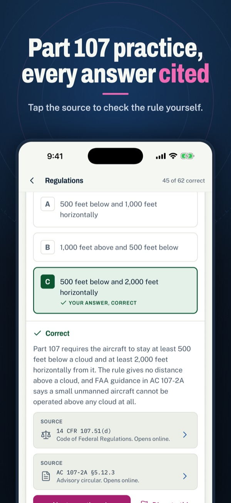
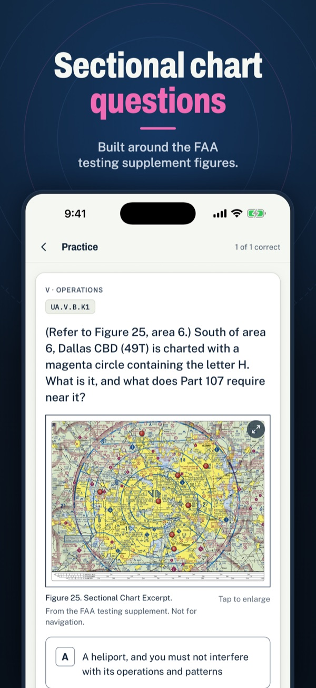
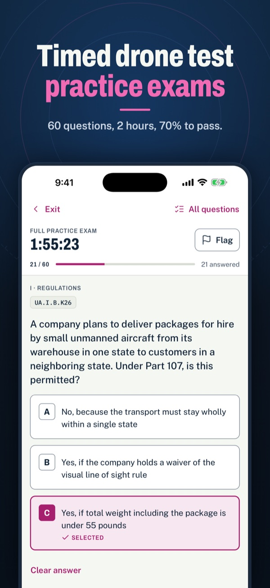
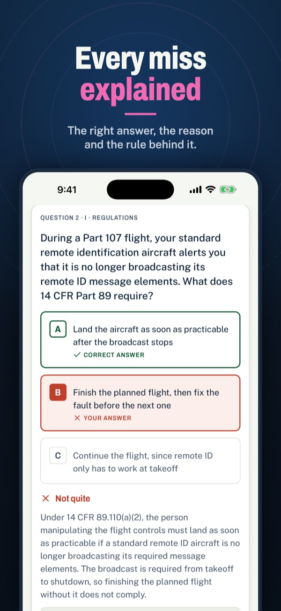

  

<h1 align="center">Part 107 Trainer</h1>

  <b>Pass the FAA Part 107 drone test with charts you can actually read.</b> 
  Every answer cited. Every FAA figure offline. Practice exams on the real clock.

  

  <a href="https://part107-trainer.vercel.app/">Website</a> ·
  <a href="https://part107-trainer.vercel.app/privacy.html">Privacy</a> ·
  <a href="https://part107-trainer.vercel.app/terms.html">Terms</a> ·
  <a href="mailto:info@appanaventures.com">Support</a>

 

  
  
  
  

 

## Why it exists

Chart reading is the hardest part of the Part 107 knowledge test, and the FAA now puts chart images right inside the questions. Many practice apps still show those charts cropped, missing or too small to read, so students end up guessing at questions they actually know.

Part 107 Trainer was built around that problem. Every figure from the FAA testing supplement ships in the app at full resolution, and you can zoom into any of them.

## What's inside

| Feature | What you get |
| --- | --- |
| 📖 **Every answer cited** | A plain-English explanation and the FAA source behind it, such as 14 CFR 107.51(d). Tap it to check the rule yourself. |
| 🗺️ **All 98 FAA figures** | Every figure from the FAA testing supplement, offline, with pinch zoom and rotation. A charts drill collects every question that uses one. |
| ⏱️ **Real exam format** | 60 questions, 2 hours, 70% to pass, weighted like the current test. Results by ACS area, with every miss explained. |
| 🎯 **Learns your weak spots** | Missed questions come back until you get them right twice in a row. Weak spots drills the topics you miss most. |
| 📅 **A plan for your test date** | Set your date for a daily study step and optional reminders. A readiness estimate shows where you stand. |
| ⚡ **Short sessions too** | A 20 question diagnostic, a 15 question high-yield sprint and quick quizzes. |
| 🔒 **Private by design** | No account, no ads, no analytics, no tracking. Your progress stays on your device. |
| 📱 **iPhone and iPad** | Light and dark themes. Works offline. |

**321 questions across all five ACS areas:** regulations, airspace, weather, loading and performance, and operations.

## One purchase, everything included

No subscription, no in-app purchases and no ads.

## Found a mistake?

Tap **Dispute this** on any question. The report goes from your own mail app, and the question shows it's under review until it's checked. You can also write to [info@appanaventures.com](mailto:info@appanaventures.com).

## Sources

Questions and explanations are written for this app from public FAA sources:

- [14 CFR Part 107](https://www.ecfr.gov/current/title-14/chapter-I/subchapter-F/part-107)
- [Remote Pilot Airman Certification Standards](https://www.faa.gov/training_testing/testing/acs)
- [FAA airman knowledge testing supplements](https://www.faa.gov/training_testing/testing/supplements)
- [FAA Remote Pilot Study Guide](https://www.faa.gov/sites/faa.gov/files/regulations_policies/handbooks_manuals/aviation/remote_pilot_study_guide.pdf)

These are practice questions, not questions from the FAA test, and passing them doesn't guarantee a pass on the real one. From October 26, 2026 some test questions use sectional chart images that aren't in the testing supplement, so study current sectional charts as well.

---

Part 107 Trainer is an independent study aid by Appana Ventures LLC. It is not affiliated with, endorsed by, or sponsored by the Federal Aviation Administration or any government agency. FAA figures are labeled not for navigation. © 2026 Appana Ventures LLC.
